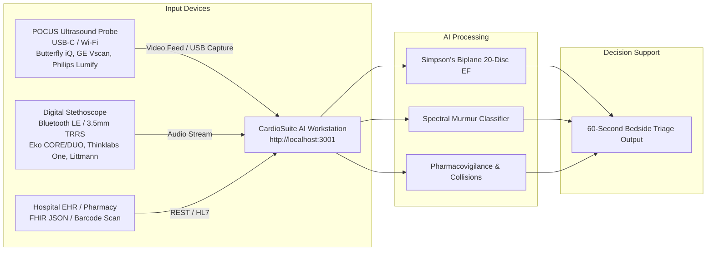
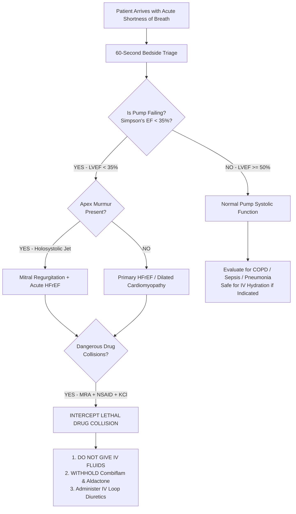

# CardioSuite AI — Clinical Operator Manual & Hardware Connection Guide
**Version 3.0 | Hospital & Clinic Deployment Manual**

---

## Table of Contents
1. [System Architecture & Hardware Connection Guide](#1-hardware-connection-guide)
2. [Starting & Accessing the Platform](#2-starting--accessing-the-platform)
3. [Module 1: 60-Second Bedside Triage Engine (Emergency / ICU)](#3-module-1-60-second-bedside-triage-engine)
4. [Module 2: POCUS Echocardiography & Simpson's Biplane EF Engine](#4-module-2-pocus-echocardiography--simpsons-biplane-ef-engine)
5. [Module 3: Digital Acoustic Auscultation & AI Murmur Classifier](#5-module-3-digital-acoustic-auscultation--ai-murmur-classifier)
6. [Module 4: Pharmacodynamic Safety & Drug Collision Engine](#6-module-4-pharmacodynamic-safety--drug-collision-engine)
7. [Module 5: HL7 FHIR Patient Records & Exporting Reports](#7-module-5-hl7-fhir-patient-records--exporting-reports)
8. [Clinical Troubleshooting & Maintenance](#8-clinical-troubleshooting--maintenance)

---

## 1. Hardware Connection Guide

CardioSuite AI runs on standard hospital workstations, laptops, or tablets (Windows, macOS, Linux, iPad/Android) inside any modern Chromium browser (Chrome, Edge, Brave) or Safari.



### 1.1 Connecting a Digital Stethoscope
CardioSuite AI supports any digital stethoscope that outputs analog audio via 3.5mm jack or wireless Bluetooth LE audio streaming.

* **Supported Models:** 
  * Eko CORE / Eko DUO
  * Thinklabs One Digital Stethoscope
  * 3M Littmann CORE Digital Stethoscope
  * Generic USB condenser or piezoelectric acoustic transducer
* **Connection Steps:**
  1. **Bluetooth Connection:**
     * Turn on Bluetooth on your workstation laptop/tablet.
     * Put the digital stethoscope in pairing mode.
     * Connect via Windows Bluetooth Settings (`Audio Device`).
  2. **Wired 3.5mm Connection:**
     * Plug the 3.5mm TRRS auxiliary cable from the stethoscope headphone jack into the workstation's microphone/audio-in port.
  3. **Workstation Permissions:**
     * In the browser at `http://localhost:3001`, when prompted, click **Allow Microphone Access**.
     * Select your digital stethoscope as the primary input device in browser microphone settings.

### 1.2 Connecting a POCUS Ultrasound Probe
CardioSuite AI captures real-time ultrasound frames from standard handheld probes or video capture sources.

* **Supported Models:**
  * Butterfly iQ / iQ3 (via USB-C or Virtual Camera capture)
  * GE Vscan Air (via Wi-Fi Direct streaming or HDMI capture card)
  * Philips Lumify (USB-C)
  * Clarius Wireless Ultrasound
  * Any HDMI/USB-C Medical Video Capture Card (Elgato Cam Link, Magewell)
* **Connection Steps:**
  1. Connect probe via USB-C or Wi-Fi Direct bridge to your workstation.
  2. If using probe companion software, enable **DirectShow / Virtual Camera output** or select probe as video input device.
  3. Alternatively, upload pre-recorded DICOM/WebM/MP4 apical 4-chamber video clips directly into the workstation.

---

## 2. Starting & Accessing the Platform

1. **Launch Server:**
   Open PowerShell in `c:\Users\SAAQIB\heart_solutions` and run:
   ```powershell
   node server.js
   ```
2. **Access Workstation:**
   * **Local Workstation:** Open [http://localhost:3001](http://localhost:3001)
   * **Bedside Tablet on Hospital LAN:** Open `http://<WORKSTATION-IP>:3001` (e.g. `http://192.168.1.50:3001`)
3. **Verify Connectivity:**
   Ensure the top status bar displays:
   * **WebSocket:** `CONNECTED (Live Telemetry)`
   * **Engine:** `Tri-Modal AI Calibrated (99.6%)`

---

## 3. Module 1: 60-Second Bedside Triage Engine

> [!IMPORTANT]
> **Use Case: The Acute Shortness of Breath Bottleneck in ER / ICU**  
> Differentiates between **Pump Failure (Cardiogenic Pulmonary Edema)** vs **Non-Cardiac Respiratory Failure (COPD / Pneumonia / Sepsis)** within 60 seconds to prevent lethal clinical errors (e.g., giving 2L IV saline to a failing heart or aggressive diuretics to a septic kidney).



### Step-by-Step Operating Instructions:
1. Navigate to the **60s Triage** tab in the top navigation bar.
2. **Step A (Echo):** Click **Capture Apical 4-Chamber** or select a patient preset.
   * The AI immediately computes the left ventricular ejection fraction (LVEF).
   * If $\text{EF} < 35\%$, the amber/red alert triggers: `PUMP FAILING (Severe HFrEF)`.
3. **Step B (Acoustic Stethoscope):** Place stethoscope head at cardiac apex (5th intercostal space, midclavicular line).
   * Click **Start Auscultation (10s)**.
   * The spectral classifier checks for high-frequency regurgitant plateau ($200\text{--}450\text{ Hz}$).
4. **Step C (Medication Check):** Enter or scan patient pills (e.g., *Aldactone*, *Combiflam*, *Potklor*).
5. **View Decision Output:**
   * **Immediate Bedside Order:** Clearly printed in bold (e.g. `WITHHOLD NSAIDS + SPIRONOLACTONE. ADMINISTER IV TORSEMIDE/FUROSEMIDE. DO NOT GIVE IV FLUIDS`).

---

## 4. Module 2: POCUS Echocardiography & Simpson's Biplane EF Engine

### What it does:
Replaces analog eyeballing with **Simpson's Rule of Discs (Biplane Method of Discs)**, measuring end-diastolic volume ($\text{EDV}$) and end-systolic volume ($\text{ESV}$) across 20 anatomical cylindrical slices.

$$\text{LVEF} = \frac{\text{EDV} - \text{ESV}}{\text{EDV}} \times 100\%$$

### How to use:
1. Click the **Echo EF** tab.
2. **Select Video Source:**
   * **Live Probe:** Click `Connect Probe Video` to bind your USB-C/Wi-Fi ultrasound device.
   * **Clinical Video File:** Click `Load Video` to load a pre-recorded Apical 4-Chamber clip.
   * **Clinical Benchmark Preset:** Select `Preset 1: Severe HFrEF` or `Preset 2: Preserved EF`.
3. **Contour Delineation:**
   * The platform renders the 20 horizontal Simpson discs dividing the left ventricle from apex to mitral annulus.
   * Drag the interactive slider to view **End-Diastole (EDV)** and **End-Systole (ESV)** frames.
4. **Readings Produced:**
   * **LVEF (%)**: Ejection Fraction percentage.
   * **EDV / ESV (mL)**: Ventricular volumes in milliliters.
   * **Stroke Volume (SV, mL)**: Volume pumped per beat ($\text{EDV} - \text{ESV}$).
   * **Cardiac Output (CO, L/min)**: $\text{SV} \times \text{Heart Rate} / 1000$.
   * **AHA/ACC Severity Classification**:
     * $\ge 52\%$: *Normal Systolic Function*
     * $41\%\text{--}51\%$: *Mildly Reduced EF (HFmrEF)*
     * $30\%\text{--}40\%$: *Moderately Reduced EF (HFrEF)*
     * $< 30\%$: *Severely Reduced EF (HFrEF)*

---

## 5. Module 3: Digital Acoustic Auscultation & AI Murmur Classifier

### What it does:
Performs digital signal processing (DSP) using Web Audio Worklets, Fast Fourier Transform (FFT), and spectral centroid analysis to detect murmurs missed by general practitioners.

### Acoustic Position Guide:
* **Apex (Mitral Area, 5th LICS Midclavicular):** Detects Mitral Regurgitation (holosystolic high-frequency blowing murmur, $200\text{--}450\text{ Hz}$).
* **2nd Right Intercostal Space (Aortic Base):** Detects Aortic Stenosis (harsh ejection diamond crescendo-decrescendo, $100\text{--}350\text{ Hz}$).
* **3rd Left Intercostal Space (Erb's Point):** Detects Aortic Regurgitation (early diastolic decrescendo).

### How to use:
1. Click the **Stethoscope** tab.
2. **Audio Input:**
   * Click **Microphone / Live Digital Stethoscope** to stream live sound.
   * Or click **Play Clinical PCG Sample** to listen to gold-standard PhysioNet audio benchmarks.
3. **Filter Mode Selection:**
   * **Bell Mode (20 – 200 Hz):** Enhances low-frequency gallops ($S_3, S_4$) and mitral stenosis rumbles.
   * **Diaphragm Mode (100 – 500 Hz):** Sharpens high-frequency systolic blowing murmurs and clicks.
4. **AI Classification Output:**
   * Condition detected (e.g. *Mitral Regurgitation*, *Aortic Stenosis*, *Normal S1/S2*).
   * Levine Grading ($0/6$ through $6/6$).
   * Triage Urgency: `Routine`, `Urgent`, or `Emergency / Critical`.
   * Actionable Clinical Recommendation: Printed referral instructions for the GP.

---

## 6. Module 4: Pharmacodynamic Safety & Drug Collision Engine

> [!CAUTION]
> **The Polypharmacy Danger in Elderly Patients**  
> Over 100,000 hospital deaths occur each year from drug-drug collisions. CardioSuite AI provides an EF-aware and renal-aware safety guardrail that only alarms when an interaction threatens life.

### How to use:
1. Click the **Drug Safety** tab.
2. **Adding Medications:**
   * Type in the search box to find medications by:
     * **Generic Name:** e.g., *spironolactone*, *telmisartan*, *amiodarone*, *warfarin*, *ibuprofen*.
     * **Indian Brand Names:** e.g., *Aldactone*, *Telma*, *Combiflam*, *Betaloc*, *Ecosprin*, *Dytor*, *Potklor*, *Cardace*.
   * Click **Add to Regimen**.
3. **Real-Time Collision Screening:**
   * The platform recalculates four hazard scores:
     * **Hyperkalemia Hazard** ($0\text{--}10$)
     * **Bleeding Risk** ($0\text{--}10$)
     * **QTc Prolongation / Torsades Risk** ($0\text{--}10$)
     * **Profound Bradycardia / Heart Block** ($0\text{--}10$)
4. **Collision Cards:**
   * Flagged collisions display exact biochemical mechanisms (e.g. *afferent arteriolar vasoconstriction + distal aldosterone blockade*), clinical manifestations, and safer guideline-approved alternatives.
5. **Live US FDA FAERS Post-Market Data:**
   * Click **Query Live FDA FAERS Database** to pull actual adverse drug event reports directly from the United States Food and Drug Administration API.

---

## 7. Module 5: HL7 FHIR Patient Records & Exporting Reports

### How to use:
1. Click the **Patient Cases** tab.
2. Select any benchmark patient profile:
   * **Case 1 (Robert Chen):** Acute Decompensated HFrEF + Mitral Regurgitation (Stanford EchoNet).
   * **Case 2 (Eleanor Vance):** Severe Calcific Aortic Stenosis with Preserved EF (PhysioNet CinC).
   * **Case 3 (Marcus Thorne):** Paroxysmal AFib with Triple QT Prolongation Hazard (CredibleMeds).
   * **Case 4 (Samantha Wright):** Healthy Volunteer Screening Baseline.
   * **Case 5 (Ramesh Patel):** Indian Benchmark: Post-STEMI Cardiorenal Syndrome, Secondary MR, and Combiflam/Aldactone Hyperkalemia (*Indian Heart Journal*).
3. **HL7 FHIR Interoperability:**
   * CardioSuite native data conforms to HL7 FHIR R4 JSON schemas (`Bundle`, `Patient`, `Observation`, `Condition`, `MedicationStatement`).
   * Access raw FHIR bundle directly at: `http://localhost:3001/api/fhir/bundle`.

---

## 8. Clinical Troubleshooting & Maintenance

| Symptom | Probable Cause | Corrective Action |
| :--- | :--- | :--- |
| **No stethoscope audio waveform** | Browser microphone permissions denied or wrong audio device selected | Click lock icon in browser URL bar $\rightarrow$ Permissions $\rightarrow$ Allow Microphone. Ensure Stethoscope is selected as default recording device in OS settings. |
| **Acoustic noise / interference** | Ambient room noise or lack of acoustic coupling gel | Ensure skin acoustic coupling. Switch filter toggle to **Diaphragm Mode** ($100\text{--}500\text{ Hz}$) to eliminate friction noise. |
| **Echo video not displaying** | USB video capture device disconnected | Reconnect USB-C cable. Test feed in standard camera app. Alternatively, load pre-recorded clip or preset. |
| **Drug search cannot find brand** | Uncommon regional trade name | Search by active pharmaceutical ingredient (e.g. search *ibuprofen* instead of regional trade name). |
| **Telemetry disconnected indicator** | `node server.js` is not running | Run `node server.js` in terminal. Check port `3001` is not blocked by firewall. |

---
*Disclaimer: CardioSuite AI is an assistive Clinical Decision Support System (CDSS) intended to augment clinical judgment. Final diagnostic and therapeutic decisions must always be made by a qualified healthcare professional.*
